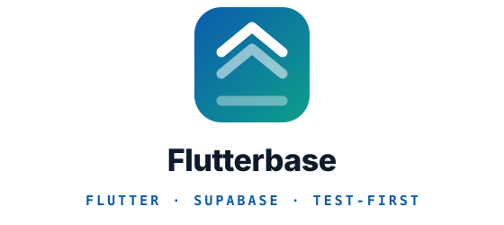

<p align="center">
  <picture>
    <source media="(prefers-color-scheme: dark)" srcset="assets/logo-dark.svg">
    
  </picture>
</p>

<p align="center"><em>Flutter and Supabase engineering for AI agents: architecture, screens, state, data, measured
performance, accessibility, localization and store release, built test-first.</em></p>

<p align="center">
  <a href=".claude-plugin/plugin.json"></a>
  <a href="LICENSE"></a>
  
  <a href="https://github.com/kratagyaagarwal2262/flutterbase/actions/workflows/validate.yml"></a>
  
</p>

**Docs:** [Install](#install) · [Reference](#reference) · [Slots](#flutter--supabase-slots) ·
[Agents](agents/README.md) · [Changelog](CHANGELOG.md)

**Let your agent install it:** point it at [INSTALL.md](INSTALL.md).

---

Skills and agents for **engineering** Flutter apps and their Supabase backends rather than
vibe-coding them: lay down a feature-first architecture, build screens, state, models and
repositories test-first, measure performance before touching it, keep accessibility and
localization honest, and produce the store pack.

Flutterbase is a **stack kit**. On its own, its skills fire when a request is about Flutter or
Supabase work. Beside [Spec-to-Ship](https://github.com/kratagyaagarwal2262/spec-to-ship), the project and delivery kit, it
answers Spec-to-Ship's `project-stack` slots (setup, conventions, design, build, verify, release) for
every Flutter app and Supabase backend in a project. It never calls a Spec-to-Ship skill, so it works
without it.

Every skill is small, readable, and adapts to the stack the project already uses. A Riverpod
project gets Riverpod, a Provider project gets Provider.

## Install

Flutterbase installs **once for your user**, not into each project, and works with Claude Code, Codex,
opencode, Antigravity and Cursor, alone or side by side.

### 1. Get it

**Let your agent do it.** In any of the five harnesses, say:

> Install Flutterbase for me by following
> https://raw.githubusercontent.com/kratagyaagarwal2262/flutterbase/main/INSTALL.md

It detects which harnesses you have, asks which you want, installs, and checks the result.

**Or do it yourself:**

```bash
# Codex, opencode, Antigravity, Cursor: any combination
curl -fsSL https://raw.githubusercontent.com/kratagyaagarwal2262/flutterbase/main/install.sh | bash -s -- --for codex,cursor

# every harness found on this machine
curl -fsSL https://raw.githubusercontent.com/kratagyaagarwal2262/flutterbase/main/install.sh | bash -s -- --detect
```

```text
# Claude Code installs as a managed plugin, from inside Claude Code
/plugin marketplace add kratagyaagarwal2262/flutterbase
/plugin install flutterbase@kratagyaagarwal
```

Including `claude` in `--for` runs those two commands for you when the `claude` CLI is on your PATH.

| Harness | Skills | Commands (human-started skills) | Agents | Hooks |
|---|---|---|---|---|
| Claude Code | plugin | native | native | native |
| Codex | `~/.agents/skills` | none: every skill is model-invoked | converted to TOML | `~/.codex/hooks.json` |
| opencode | `~/.agents/skills` | none: every skill is model-invoked | converted | global plugin |
| Antigravity | `~/.gemini/config/skills` | not supported: the agent may start any skill | native | `~/.gemini/config/hooks.json` |
| Cursor | `~/.agents/skills` | native | native | `~/.cursor/hooks.json` |


Codex, opencode and Cursor read one shared folder, so installing for all three costs one copy. Run
`kit doctor` (in `~/.flutterbase/bin`) any time to see what each harness loads and whether a skill shows up
twice. `kit uninstall` removes exactly what was installed and keeps your own settings.
`install/harnesses.json` is the registry of these paths.

**Updating.** `kit update` installs the latest release for every harness you already have, then
prints what changed since your version, including any **Migration** step a project needs. Restart
the harness afterwards. In Claude Code, `/plugin` updates the plugin; `kit update` runs that too
when `claude` is on your PATH. The install line always fetches the latest release; add
`--version vX.Y.Z` to stay on one.

### 2. Set up a project

Once per project, ask your agent to set the project up with Flutterbase. It calls
`flutter-supabase-setup`, which will:

- Explore the repo and ask only the few things it cannot observe
- Fill in the **Architecture table**, which records the stack this project actually uses
- Write its sections of `docs/agents/project.md`, `CLAUDE.md`, and an `AGENTS.md` twin for every other harness
- Add the path-scoped rules that match the project's stack
- Scaffold `lib/core` if the repo is greenfield, or audit it if it was inherited

Every other skill reads `docs/agents/project.md`, which is what makes one kit serve many apps.

### 3. That's it

Ask for Flutter or Supabase work in plain words; the matching skill fires. Beside Spec-to-Ship, `/fk-build` and `/fk-release` reach the same skills through the slots.

---

## Why this exists

Four failures, each one the reason for a group of skills.

### #1. We said done without proving it

**The problem.** "Done" degrades into "it compiles and the happy path looked fine on my simulator."
Nobody ran the error state. Nobody checked it against the spec, only against taste.

**The fix** is to build test-first and to name your evidence.
[`flutter-write-tests`](./skills/flutter-write-tests/SKILL.md) covers logic, widget and golden
levels, and [`flutter-supabase-verify`](./skills/flutter-supabase-verify/SKILL.md) drives a claim up
the verification rungs and names the one it reached.
[`setup-integration-harness`](./skills/setup-integration-harness/SKILL.md) builds the top rung when
the project has none.

### #2. It got slow and nobody measured

**The problem.** "The list feels janky." Someone sprinkles `const` and `RepaintBoundary`, it feels
about the same, and nobody can say whether anything improved. Meanwhile the actual cost was an image
decoded at full resolution on the raster thread.

**The fix** is a measurement, then one change, then the same measurement.
[`flutter-performance`](./skills/flutter-performance/SKILL.md) owns that loop, starting with the
question that decides everything after it: is the UI thread or the raster thread over budget.

### #3. It rotted

**The problem.** Dependencies drift until an upgrade is a week's work. The native build breaks on a
new machine and nobody knows which version disagreed. Accessibility and localization were never
anyone's job.

**The fix** is to make each of those a named, small task rather than an eventual crisis:
[`flutter-upgrade-deps`](./skills/flutter-upgrade-deps/SKILL.md),
[`flutter-build-failure`](./skills/flutter-build-failure/SKILL.md),
[`flutter-accessibility`](./skills/flutter-accessibility/SKILL.md) and
[`flutter-localization`](./skills/flutter-localization/SKILL.md).

### #4. It was correct and it looked amateur

**The problem.** Everything above can hold and the result still reads as unfinished. The loading
state is a spinner over content the user was reading, the empty state says "No data", the error shows
what the exception returned, and something animates on a tab switch a user makes forty times a day.
None of it is a bug, so no test catches it and no review flags it.

**The fix** is to make the design decisions explicit rather than leaving them to whatever the first
draft produced. [`flutter-design`](./skills/flutter-design/SKILL.md) holds the gates (how often a
thing is seen, what an animation is *for*, what belongs in a state nobody drew) and makes the answer
name what it chose not to do.

---

## Reference

Every skill here is model-invoked: the agent reaches for one when a request clearly needs it, and
`flutter-supabase-*` skills also answer Spec-to-Ship's slots when it is installed. Nothing here is a
command you have to remember.

### Understand

Resolving the project's stack and the kit's fixed conventions before changing anything.

- **[flutter-supabase-conventions](./skills/flutter-supabase-conventions/SKILL.md)**: The
  conventions slot for a Flutter + Supabase component: which state management, serialization,
  navigation, sizing and test tooling this project actually uses, plus its test layout, review
  baseline, generated files and lockfiles, and debugging tools, each shown by a file.
- **[flutter-core-architecture](./skills/flutter-core-architecture/SKILL.md)**: The kit's lib/core
  conventions: project structure, barrel imports, constants families, shared components, services,
  network, failures, router, and fixture markers.

### Build

Writing the code. `flutter-supabase-build` is the entry point: it hands a new feature folder to `flutter-scaffold-feature` and a change to existing code to the layer skills.

- **[flutter-scaffold-feature](./skills/flutter-scaffold-feature/SKILL.md)**: Scaffold a complete
  feature folder (model, repository, state layer, view, widgets, tests) from acceptance criteria, in
  one of three modes: real (a model and endpoint exist), fixture (build the screen first, the API
  comes later) or upgrade (move a fixture-mode feature onto its real API).
- **[flutter-create-state-layer](./skills/flutter-create-state-layer/SKILL.md)**: Generate a
  feature's state layer in whichever state management the project uses: the seam holding its
  behaviour, its actions, and the state the UI reads back.
- **[flutter-create-model](./skills/flutter-create-model/SKILL.md)**: Generate request and response
  DTO classes for a feature, immutable and with JSON serialization in whichever mechanism the
  project uses.
- **[flutter-create-repository](./skills/flutter-create-repository/SKILL.md)**: Generate a
  Repository class for a feature with dependency-injected API client and proper error handling using
  Either.
- **[flutter-create-screen](./skills/flutter-create-screen/SKILL.md)**: Generate a screen (view +
  widgets) from a Figma node URL (read via the Figma MCP server), or a pasted CSS + screenshot
  fallback, or a written spec.
- **[flutter-design](./skills/flutter-design/SKILL.md)**: Judge and shape what a screen looks like
  and how it moves, when no design source settles it: visual hierarchy, the states a build skips,
  and whether something should animate at all.
- **[flutter-navigation](./skills/flutter-navigation/SKILL.md)**: Wire routes, typed arguments and
  deep links, and test that they arrive.
- **[flutter-modernize-screen](./skills/flutter-modernize-screen/SKILL.md)**: Migrate a legacy
  screen onto the project's current state management, sizing and widget conventions without changing
  what it renders.

### Prove

Separating *does it work* from *is it written well*, and answering both out loud.

- **[setup-integration-harness](./skills/setup-integration-harness/SKILL.md)**: Stand up an
  integration test harness that boots the real app, prove it runs once, and record it so
  verification can reach the top rung.
- **[flutter-write-tests](./skills/flutter-write-tests/SKILL.md)**: Write the tests for a feature:
  logic tests at the state seam, widget tests for what the user sees, and goldens for the pixels.
- **[flutter-performance](./skills/flutter-performance/SKILL.md)**: Measure and improve Flutter
  performance against a budget: jank, dropped frames, slow startup, memory growth, and app size.
- **[flutter-security-review](./skills/flutter-security-review/SKILL.md)**: The Flutter and Supabase
  depth behind a security review, covering secrets, device storage, the network layer, state,
  WebView, the Supabase backend's access rules, and code quality, with the patterns and fixes in
  Dart.

### Keep it working

The work that stops a codebase decaying between features.

- **[flutter-upgrade-deps](./skills/flutter-upgrade-deps/SKILL.md)**: Upgrade Flutter and Dart
  dependencies one at a time, with the breaking changes read first and the suite green between each.
- **[flutter-build-failure](./skills/flutter-build-failure/SKILL.md)**: Diagnose a native build
  failure: Gradle, AGP, Kotlin, JDK, CocoaPods, Xcode or signing.
- **[flutter-accessibility](./skills/flutter-accessibility/SKILL.md)**: Make a Flutter screen usable
  with a screen reader, large text and low vision, and add the tests that keep it that way.
- **[flutter-localization](./skills/flutter-localization/SKILL.md)**: Add or extend localization:
  ARB files, plurals, RTL layouts and locale-aware formatting, including migrating off a static
  strings class.

### Ship

Everything between "it works on my machine" and "it is live".

- **[store-compliance](./skills/store-compliance/SKILL.md)**: Generate the App Store / Google Play
  metadata, privacy, terms, permissions, SDK-audit and release-checklist pack for this app.

### Flutter + Supabase slots

How Flutterbase answers `project-stack`: one skill per slot of the contract, each routing to the Flutter skills above. Without Spec-to-Ship installed, they also fire on their own.

- **[flutter-supabase-setup](./skills/flutter-supabase-setup/SKILL.md)**: Configure a Flutter app or
  Supabase backend component: its Architecture table from the code, its commands in the Components
  table, its sections of docs/agents/project.md, CLAUDE.md and AGENTS.md, its path-scoped rules, and
  the lib/core scaffold on a greenfield app.
- **[flutter-supabase-design](./skills/flutter-supabase-design/SKILL.md)**: The design slot for a
  Flutter client component: settle or recover the app's design language and write or confirm
  docs/agents/design.md.
- **[flutter-supabase-build](./skills/flutter-supabase-build/SKILL.md)**: Build one ticket's slice
  in a Flutter app and its Supabase backend, test-first, with the backend change landing first, a
  new feature folder going through the scaffold, a change to existing code through the layer skills,
  and mechanical slices handed to the layer agents.
- **[flutter-supabase-verify](./skills/flutter-supabase-verify/SKILL.md)**: The verification rungs
  and exact commands for a Flutter app or Supabase backend component, and a claim driven up them to
  the highest rung it needs, with the rung reached named.
- **[flutter-supabase-release](./skills/flutter-supabase-release/SKILL.md)**: Produce what a Flutter
  app or Supabase backend component ships: signed release builds per flavor and platform, the store
  submission pack, and the steps only a person can take.

## Agents

Layer specialists the scaffolding skills delegate to: `flutter-state-engineer`,
`flutter-repo-engineer`, `flutter-ui-engineer`, `flutter-test-engineer`, and the `store-doc-writer`
that produces the store pack. See [agents/README.md](./agents/README.md).

## What the kit assumes

Less than you might think. The **Architecture table** in `docs/agents/project.md` records what this
project actually uses, and `flutter-supabase-conventions` resolves it for every skill that generates
code. A Riverpod project gets Riverpod, a Provider project gets Provider.

What the kit still imposes, and `flutter-core-architecture` owns:

- Feature-first layout, with sharing only through `lib/core/`
- A single barrel import per file
- No hardcoded colours, strings, assets or dimensions
- Spacing tokens in logical pixels, breakpoints for layout, and font sizes left for the OS to scale
- Fixture mode: screens can ship before their API exists, explicitly marked, then upgraded

Its defaults for a greenfield repo are `flutter_bloc`, `dartz` and `dio`, which is what
`flutter-supabase-setup` scaffolds when nothing contradicts it.

## Editing the kit

Read the `writing-for-agents` skill from Spec-to-Ship first if you have it. `scripts/kit.py` is the
installer and `install/harnesses.json` is the one list of supported harnesses. Then the rule that
keeps this portable: **a project fact never goes in a skill.** If it is true of one app but not of
every Flutter app, it belongs in `docs/agents/project.md`. A skill carries everything it reads, so
the same folder works in every harness's install location. `CLAUDE.md` in this repo carries the
authoring conventions. Run `python3 scripts/validate-kit.py` before committing: it checks that every
skill appears in this README with a description matching its frontmatter, that no skill outside
`templates/` names a state management library, and that the installer works.

## Credits

`flutter-design` adapts its motion judgment (the frequency and purpose gates, the duration budgets,
the physicality and interruptibility rules, and the habit of naming what you chose *not* to animate)
from [`emilkowalski/skills`](https://github.com/emilkowalski/skills) (MIT), chiefly
`emil-design-eng`, `animate`, `animate-expo`, `review-animations`, `find-animation-opportunities`
and `apple-design`. The gates port because they are claims about human perception; the
implementations are CSS and React Native and were rewritten for Flutter. `flutter-performance`
adapts the measure-change-measure discipline from
[pstack](https://github.com/cursor/plugins/tree/main/pstack) by Lauren Tan (MIT).
